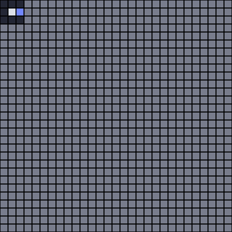
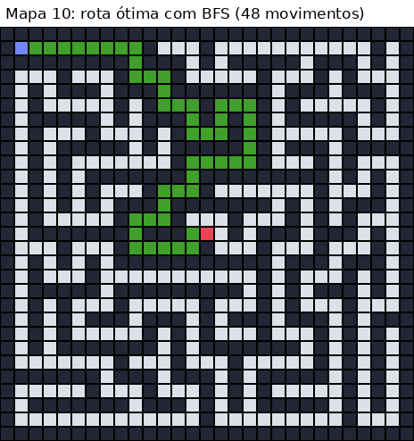
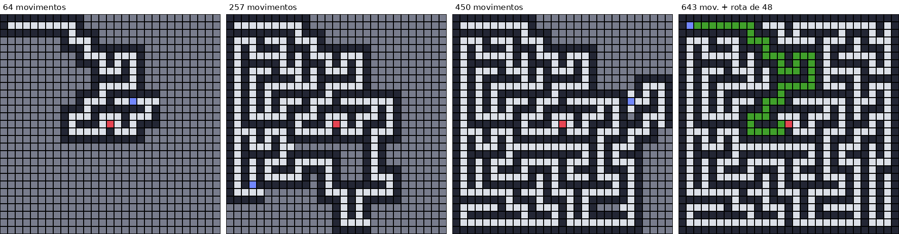
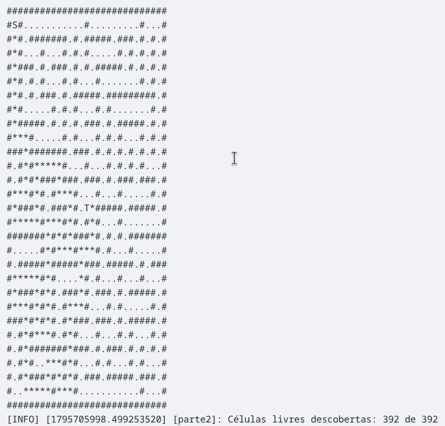
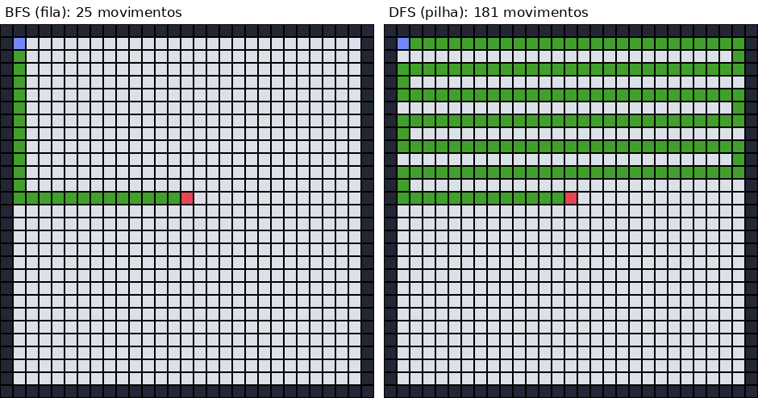

# Ponderada de navegação autônoma

Solução da atividade ponderada de navegação do labirinto usando o repositório
[Culling Games](https://github.com/rmnicola/culling_games) (ROS 2 + pygame).

- **Parte 1 (navegação com mapa):** o robô recebe o mapa completo e segue a
  rota ótima até o alvo, calculada com **busca em largura (BFS)**.
- **Parte 2 (mapeamento):** o robô começa sem conhecer o labirinto, explora
  usando só o sensor até mapear tudo e prova que o mapa criado reproduz a
  rota da parte 1.



*Parte 2 no mapa 10: o cinza é o que o robô ainda não conhece. Ao fim da
exploração, a rota calculada com o mapa construído aparece em verde.*

## Sumário

- [Resultados](#resultados)
- [Como rodar](#como-rodar)
- [Estrutura do repositório](#estrutura-do-repositório)
- [Parte 1: navegação com mapa](#parte-1-navegação-com-mapa)
- [Parte 2: mapeamento do labirinto](#parte-2-mapeamento-do-labirinto)
- [Por que BFS e não DFS](#por-que-bfs-e-não-dfs)
- [Testes](#testes)
- [Cuidados com o simulador](#cuidados-com-o-simulador)

## Resultados

Execuções com o simulador real em todos os mapas do repositório:

| Mapa | Parte 1: rota ótima | Parte 2: movimentos explorando | Células livres mapeadas | Parte 2: rota pelo mapa explorado |
|---|---:|---:|---:|---:|
| 1 | 102 | 635 | 392 / 392 | 102 |
| 2 | 102 | 705 | 392 / 392 | 102 |
| 3 | 192 | 677 | 392 / 392 | 192 |
| 4 | 114 | 697 | 392 / 392 | 114 |
| 5 | 204 | 619 | 392 / 392 | 204 |
| 6 | 110 | 607 | 392 / 392 | 110 |
| 7 | 96 | 707 | 392 / 392 | 96 |
| 8 | 164 | 653 | 392 / 392 | 164 |
| 9 | 190 | 709 | 392 / 392 | 190 |
| 10 | 48 | 643 | 392 / 392 | 48 |
| test | 25 | 390 | 729 / 729 | 25 |

Em todos os casos, nenhuma célula anotada pelo robô diferiu do mapa real, e
ele chegou ao alvo. Também foram testados labirintos gerados com `--generate`
e um mapa sem solução, em que o programa avisa que não existe caminho.

## Como rodar

### Requisitos

- ROS 2 Jazzy, com `colcon`
- pygame: `sudo apt install python3-pygame`

### Compilar

Na **raiz do repositório** (não dentro de `culling_games`), compile todos os
pacotes de uma vez:

```bash
colcon build
source install/setup.bash
```

Rode `source install/setup.bash` em todo terminal novo.

### Executar

**Terminal 1: o simulador**

```bash
ros2 run cg maze -- --map 10.csv
```

**Terminal 2: a solução**

```bash
ros2 run cg_reimar parte1   # navegação com mapa
ros2 run cg_reimar parte2   # exploração + comprovação + rota
```

As duas partes começam com um reset, então podem ser executadas várias vezes
seguidas, na ordem que quiser.

## Estrutura do repositório

```text
.
├── culling_games/              simulador original (não modificado)
├── src/cg_reimar/              pacote ROS 2 da solução
│   ├── cg_reimar/
│   │   ├── busca.py            BFS e utilitários de mapa (sem ROS)
│   │   ├── exploracao.py       exploração por fronteira (sem ROS)
│   │   ├── cliente.py          nó ROS: serviços, sensor e encerramento
│   │   ├── parte1.py           parte 1
│   │   └── parte2.py           parte 2 e comprovação
│   └── test/
│       ├── test_busca.py       BFS nos 11 mapas
│       └── test_exploracao.py  exploração nos 11 mapas, sem ROS
└── img/
```

Os algoritmos (`busca.py` e `exploracao.py`) não dependem do ROS. Isso
permite testá-los em milissegundos, e o nó ROS (`cliente.py`) só faz a ponte
com o simulador.

## Parte 1: navegação com mapa

### Modelagem

O labirinto é um **grafo**: cada célula livre é um vértice, e duas células
livres vizinhas (cima, baixo, esquerda ou direita) são ligadas por uma aresta
de custo 1. O mapa é guardado como um dicionário `{(linha, coluna): valor}`.

### Algoritmo

1. Reinicia o labirinto e pede o mapa completo pelo serviço `/get_map`.
2. Encontra a posição do robô (`r`) e do alvo (`t`).
3. Roda a **BFS** do robô até o alvo.
4. Converte o caminho em direções (`up`, `down`, `left`, `right`) e envia cada
   uma pelo serviço `/move_command`.
5. Confere se a posição final informada pelo simulador é o alvo.

```python
def bfs(livres, inicio, eh_objetivo):
    fila = deque([inicio])
    pai = {inicio: None}

    while fila:
        atual = fila.popleft()
        if eh_objetivo(atual):
            return reconstruir(pai, atual)
        for vizinho in vizinhos(atual):
            if vizinho in livres and vizinho not in pai:
                pai[vizinho] = atual
                fila.append(vizinho)

    return None
```

**Por que a rota é ótima:** a fila faz a BFS visitar as células em camadas,
primeiro todas a 1 passo, depois todas a 2, e assim por diante. Como toda
aresta custa 1, a primeira vez que o alvo sai da fila é pelo menor número de
passos possível.

**Complexidade:** O(V + E), em que V é o número de células livres e E o de
conexões entre elas. Cada célula entra na fila no máximo uma vez, porque
`pai` marca as já descobertas.

O objetivo é passado como **função** (`eh_objetivo`), e não como uma
posição. Assim, a mesma BFS serve para a parte 2, onde o objetivo passa a ser
"a fronteira mais próxima".



## Parte 2: mapeamento do labirinto

### O que o robô sabe

Nada além do que o sensor mostra: as **8 células ao redor**, publicadas no
tópico `/culling_games/robot_sensors`. A parte 2 não usa `/get_map` para
navegar, nem as posições `robot_pos` e `target_pos` que o `/move_command`
devolve.

A posição é **relativa ao ponto de partida**, que é `(0, 0)`. Ela é
atualizada por odometria: a cada movimento bem-sucedido, soma-se o
deslocamento da direção.

### Exploração por fronteira

Uma **fronteira** é uma célula livre conhecida com pelo menos um vizinho
ainda desconhecido. Ir até ela revela células novas.

```text
repita:
    anota as 8 células vistas pelo sensor
    BFS da posição atual até a fronteira mais próxima
    se não existe fronteira: o mapa está completo, fim
    anda pelo caminho, anotando o sensor a cada passo
    (se o destino deixar de ser fronteira no meio do caminho, replaneja)
```

Detalhes importantes:

- **A busca é a mesma BFS da parte 1**, trocando só o objetivo. Por isso a
  fronteira escolhida é sempre a mais próxima.
- **O robô nunca pisa no alvo durante a exploração.** Pisar no alvo encerra o
  jogo, então o alvo é anotado, mas tratado como intransitável até o fim.
- **Explora tudo, e não para ao ver o alvo.** Os mapas têm ciclos, e o mapa
  `test` é totalmente aberto. A rota ótima pode passar por um trecho ainda
  não visto. Só com o mapa completo dá para garantir a mesma rota da parte 1.
- **Segue até o destino escolhido**, em vez de replanejar a cada passo. Com
  duas fronteiras à mesma distância, replanejar a cada passo pode fazer o
  robô oscilar entre elas indefinidamente.



### Comprovação

Depois de explorar, o programa:

1. calcula a rota com a BFS sobre o **mapa construído**;
2. reinicia o labirinto e só então chama `/get_map`, **apenas para
   conferir**: quantas células livres foram descobertas, se alguma célula
   anotada difere do mapa real e se a rota tem o mesmo tamanho da rota ótima
   da parte 1;
3. executa a rota com o robô e confirma que ele chegou ao alvo.

A comparação é pelo **tamanho** da rota, porque um mapa pode ter mais de uma
rota ótima (o mapa 3 tem duas).

Saída real no mapa 10:

```text
[parte2]: Explorando sem conhecer o mapa...
[parte2]: Exploração terminou com 643 movimentos
[parte2]: Células livres descobertas: 392 de 392
[parte2]: Células anotadas diferentes do mapa real: 0
[parte2]: Rota pelo mapa explorado: 48 movimentos
[parte2]: Rota ótima pelo mapa real (parte 1): 48 movimentos
[parte2]: Comprovado: o mapa explorado reproduz a rota da parte 1
[parte2]: Executando a rota calculada com o mapa explorado...
[parte2]: Chegou ao alvo!
```

O programa também imprime o mapa descoberto em texto: `#` é parede, `.` é
livre, `S` é o início, `T` é o alvo e `*` é a rota.



## Por que BFS e não DFS

A única diferença entre as duas no código é a estrutura de dados: a BFS tira o
**primeiro** da fila (`popleft`), e a DFS tira o **último** da pilha (`pop`).
A DFS também encontra um caminho, mas sem garantia de que seja o menor.

No mapa `test`, que é aberto, a diferença é grande:



Nos mapas 1 a 10 a DFS chega ao mesmo tamanho por sorte, porque eles quase não
têm caminhos alternativos. A BFS **garante** o menor caminho em qualquer
labirinto em que todos os passos custam o mesmo. Se as células tivessem custos
diferentes, seria preciso usar Dijkstra ou A*.

## Testes

Os testes rodam sem abrir o simulador. Em `test_exploracao.py`, um
`SimuladorFalso` com as mesmas regras de movimento e sensor substitui o ROS. O
`Explorador` não percebe a diferença, porque só usa `mover()` e
`ler_sensor()`.

```bash
cd src/cg_reimar
python3 -m pytest test/test_busca.py test/test_exploracao.py
```

```text
24 passed
```

Os testes verificam, nos 11 mapas, que:

- a BFS encontra a rota com o tamanho ótimo;
- a BFS devolve `None` quando não existe caminho;
- a exploração nunca pisa no alvo;
- o mapa explorado reproduz a rota ótima;
- toda célula anotada é igual à do mapa real.

## Créditos

Simulador [Culling Games](https://github.com/rmnicola/culling_games), de
Rodrigo Nicola, incluído em `culling_games/`. Nenhum
arquivo do simulador foi alterado: toda a solução está em `src/cg_reimar/`.
